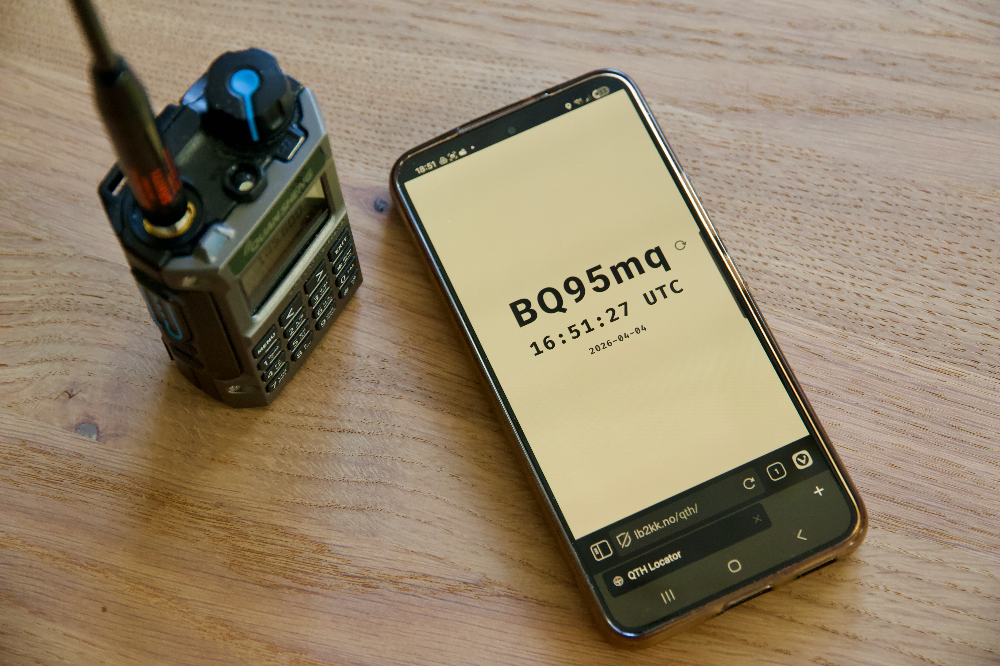
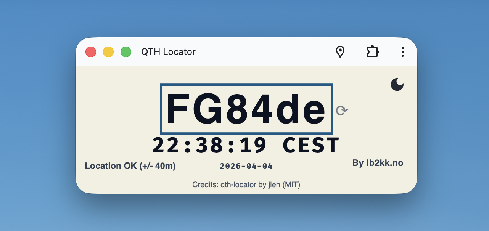
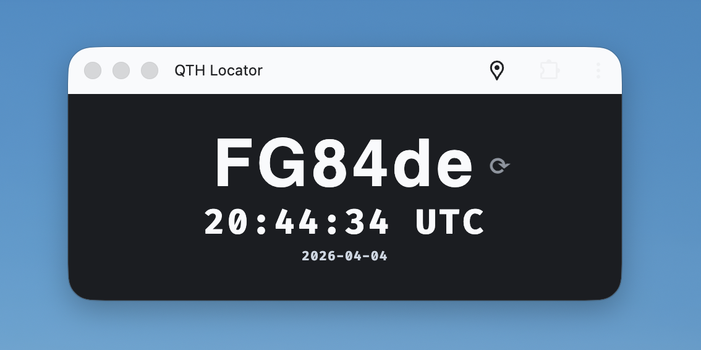
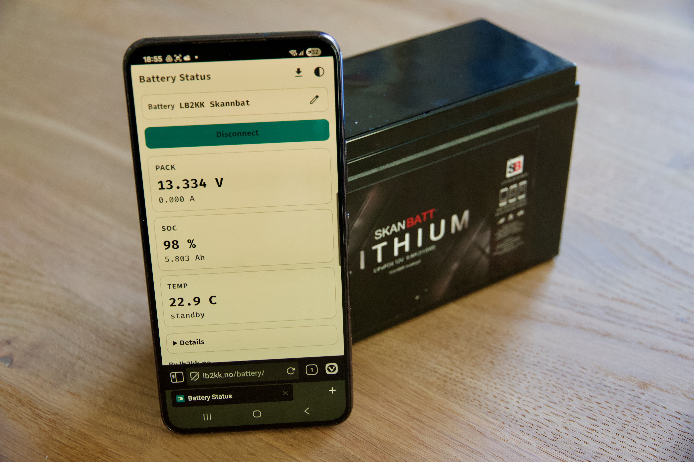
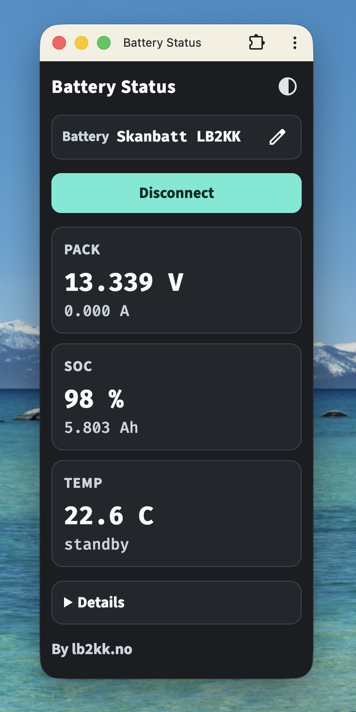

+++
title = 'Maidenhead locator and battery status apps'
date = 2026-04-04T19:07:45+02:00
draft = false
summary = "There is a lot of software available for radio amateurs. I regularly use many of these applications, but sometimes I come across one that could just as easily have been a simple web page. In this article, I write about two small tools that I have added recently: a tool that shows your Maidenhead locator and a tool that shows the voltage of my LiFePO4 battery."
tags = ['maidenhead', 'battery status', 'progressive web app', 'web bluetooth']
+++

_The QTH locator app uses the Geolocation API on the phone to show the Maidenhead locator._

I was fortunate to follow the web industry from the inside while working for Opera Software here in Oslo. This was around the time when browsers were starting to evolve from first-generation browsers into platforms with many new features. Today's web browsers are very capable and offer features such as geolocation, Bluetooth, USB, serial port access, audio, video and much more. Just take a look at [Mozilla's overview of Web APIs](https://developer.mozilla.org/en-US/docs/Web/API) to get an idea of all the capabilities included in today's browsers.

I wanted to use a few of these web standards to create some (hopefully) useful tools for radio amateurs:

* The first one is a page that simply shows the [Maidenhead locator](https://en.wikipedia.org/wiki/Maidenhead_Locator_System) and the current time in either local time or UTC. You can find it at [https://lb2kk.no/qth/](https://lb2kk.no/qth/).
* The second one is a bit more specialised and shows the voltage and other key parameters from my LiFePO4 battery. You can find it at [https://lb2kk.no/battery/](https://lb2kk.no/battery/).

## QTH locator app

The QTH locator web app shows the Maidenhead locator using the Geolocation API. It can be used in most browsers and works on iPhone, Android, macOS and Windows.

{style="width:80%"}
_The QTH locator app running on macOS._

Features:

* Shows the Maidenhead locator using the [qth-locator library](https://github.com/jleh/qth-locator).
* Supports switching between light and dark themes.
* Lets you copy the locator to the clipboard by clicking on the locator text.
* Shows the current time in either UTC or local time. Click on the time to switch between the two.
* Can optionally be installed as an app so that it can be started easily on a Mac using Spotlight, for example.
* Works offline.

{style="width:80%"}
_The QTH locator app with the dark theme, showing the current time in UTC._

## Battery status app

The battery status app is a bit more specialised, as it is built for the battery that I have. It will only work in browsers that support [Web Bluetooth](https://caniuse.com/?search=web+bluetooth). Unfortunately, that means that there is no iPhone support, but it works fine on most other platforms. I use it to quickly check the voltage of the battery.

{style="width:80%"}
_The battery status app uses Web Bluetooth to show the voltage and other metrics._

My battery is a _SKANBATT Bluetooth Lithium Batteri 12V 9AH 15A BMS_, and it exposes a Bluetooth Low Energy interface that is always running and available. The application connects to this interface and reads information from the battery management system (BMS). I don't know if this will work with other batteries, but I will try to add support for more of these batteries.

{style="width:40%"}
_The battery status app running on macOS._

## Summary

One of the key advantages of creating a web app is that there is no licence fee to pay to distribute your application. Secondly, no installation is required for the end user. Just visiting the web page is enough. Optionally, users can install the web app. Installing it gives the web app its own icon and makes it feel more like a regular app. It still runs in your web browser when you start it.

I might be a bit biased given my background at a browser company, but I really like the simplicity and cross-platform nature of web apps. I encourage you to take a look at [PWA Directory](https://pwa.directory), for example, to see more examples of progressive web apps (PWAs).
